 

 

## About

I'm a computer science undergrad who builds automation for service businesses. Most of my work is n8n workflows, GoHighLevel accounts and voice agents that answer the call, capture the enquiry and keep following up until an appointment is on the calendar.

I do this at [Zeptic Flow](https://zepticflow.com). Every system is built on the client's own accounts and handed over working, with a walkthrough recording and notes on how to change each part.

 

## What I build

<table>
  <tr>
    <td width="50%" valign="top">
      <h3>AI voice receptionist</h3>
      Answers the calls your team can't get to, day, night and weekends. It knows your hours, services and prices, takes the caller's details, books into your calendar and texts you a summary.
    </td>
    <td width="50%" valign="top">
      <h3>Lead capture and follow-up</h3>
      Calls, forms, DMs and email land in one pipeline. Each lead gets a fast first reply, gets qualified and routed, and is followed up until it books.
    </td>
  </tr>
  <tr>
    <td width="50%" valign="top">
      <h3>Content engine</h3>
      One Airtable row becomes a finished video: researched, scripted, voiced, rendered with an avatar presenter, captioned and published across platforms.
    </td>
    <td width="50%" valign="top">
      <h3>GoHighLevel build-outs</h3>
      CRM, pipelines, funnels, calendars and two-way messaging in one sub-account, set up, preloaded and handed over.
    </td>
  </tr>
</table>

 

## Recent builds

| Build | What it does | Stack |
| :-- | :-- | :-- |
| **Billing watchdog** | Audits every sub-account's wallet balance each day, pauses delinquent locations before they run up cost and posts a morning summary to Telegram. Built for a US GoHighLevel agency. | n8n, GoHighLevel API, Telegram |
| **Maps lead engine** | Pulls every business in a niche and city from Google Maps, then crawls each site to recover owner emails and direct numbers. | Python, Playwright, httpx |
| **Community poster** | Chrome extension that composes a post once and publishes it across every community the operator belongs to, with delivery logging and a dry run. | Chrome MV3, JavaScript |

Client work and most of my tools live in private repositories, so this page shows less code than I write. More detail is on [zepticflow.com](https://zepticflow.com/#work).

 

## Toolbox

  
  
  
  
  
  
  
  
  

  

 

## Work with me

If your funnel loses leads to slow follow-up, book a free 30-minute call. I'll fill in your form and call your number the way a customer would, then tell you where enquiries are dropping. You get that answer whether or not we work together.

